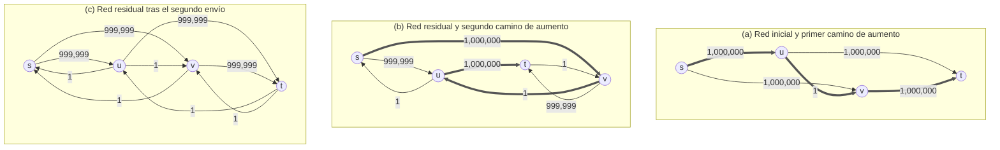

# Edmonds-Karp

***Figure 26.6:***

- a) A flow network for which FORD-FULKERSON can take $O(E |f^*|)$ time, where $f^*$ is a maximum flow, shown here with $|f^*| = 2,000,000$. An augmenting path with residual capacity 1 is shown.
- b) The resulting residual network. Another augmenting path with residual capacity 1 is shown.
- c) The resulting residual network.

Edges in $G'$, and it is therefore a simple matter to maintain capacities and flows in this data structure. Given a flow $f$ on $G$, the edges in the residual network $G_f$ consist of all edges $(u, v)$ of $G'$ such that $c(u, v) - f[u, v] \neq 0$. The time to find a path in a residual network is therefore $O(V + E') = O(E)$ if we use either depth-first search or breadth-first search. Each iteration of the while loop thus takes $O(E)$ time making the total running time of FORD-FULKERSON $O(E |f^*|)$.

When the capacities are integral and the optimal flow value $|f^*|$ is small, the running time of the Ford-Fulkerson algorithm is good. Figure 26.6(a) shows an example of what can happen on a simple flow network for which $|f^*|$ is large. A maximum flow in this network has value 2,000,000: 1,000,000 units of flow traverse the path $s \to u \to t$, and another 1,000,000 units traverse the path $s \to v \to t$. If the first augmenting path found by FORD-FULKERSON is $s \to u \to v \to t$, shown in Figure 26.6(a), the flow has value 1 after the first iteration. The resulting residual network is shown in Figure 26.6(b). If the second iteration finds the augmenting path $s \to v \to u \to t$, as shown in Figure 26.6(b), the flow then has value 2. Figure 26.6(c) shows the resulting residual network. We can continue, choosing the augmenting path $s \to u \to v \to t$ in the odd-numbered iterations and the augmenting path $s \to v \to u \to t$ in the even-numbered iterations. We would perform a total of 2,000,000 augmentations, increasing the flow value by only 1 unit in each.

## The Edmonds-Karp algorithm

The bound on FORD-FULKERSON can be improved if we implement the computation of the augmenting path $p$ in line 4 with a breadth-first search, that is, if the augmenting path is a shortest path from $s$ to $t$ in the residual network, where each edge has unit distance (weight). We call the Ford-Fulkerson method so implemented the Edmonds-Karp algorithm. We now prove that the Edmonds-Karp algorithm runs in $O(VE^2)$ time. The analysis depends on the distances to vertices in the residual network $G_f$. The following lemma uses the notation $\delta_f(u, v)$ for the shortest-path distance from $u$ to $v$ in $G_f$, where each edge has unit distance.

Lemma 26.8
If the Edmonds-Karp algorithm is run on a flow network $G = (V, E)$ with source $s$ and sink $t$, then for all vertices $v \in V - \{s, t\}$, the shortest-path distance $\delta_f(s, v)$ in the residual network $G_f$ increases monotonically with each flow augmentation.

### Proof

We will suppose that for some vertex $v \in V - \{s, t\}$, there is a flow augmentation that causes the shortest-path distance from $s$ to $v$ to decrease, and then we will derive a contradiction. Let $f$ be the flow just before the first augmentation that decreases some shortest-path distance, and let $f'$ be the flow just afterward. Let $u$ be the vertex with the minimum $\delta_{f'}(s, v)$ whose distance was decreased by the augmentation, so that $\delta_{f'}(s, v) < \delta_f(s, v)$. Let $p = s \leadsto u \to v$ be a shortest path from $s$ to $v$ in $G_{f'}$, so that $(u, v) \in E_{f'}$ and $\delta_{f'}(s, u) = \delta_{f'}(s, v) - 1$.
Because of how we chose $v$, we know that the distance label of vertex $u$ did not decrease, i.e., $\delta_{f'}(s, u) \ge \delta_f(s, u)$.
We claim that $(u, v) \notin E_f$. Why? If we had $(u, v) \in E_f$, then we would also have
$\delta_f(s, v) \le \delta_f(s, u) + 1$ (by Lemma 24.10, the triangle inequality)
$\le \delta_{f'}(s, u) + 1$ (by inequality (26.8))
$= \delta_{f'}(s, v)$ (by equation (26.7)),
which contradicts our assumption that $\delta_{f'}(s, v) < \delta_f(s, v)$.
How can we have $(u, v) \notin E_f$ and $(u, v) \in E_{f'}$? The augmentation must have increased the flow from $v$ to $u$. The Edmonds-Karp algorithm always augments flow along shortest paths, and therefore the shortest path from $s$ to $u$ in $G_f$ has $(v, u)$ as its last edge. Therefore,
$\delta_f(s, v) = \delta_f(s, u) - 1$
$\le \delta_{f'}(s, u) - 1$ (by inequality (26.8))
$= \delta_{f'}(s, v) - 2$ (by equation (26.7)),
which contradicts our assumption that $\delta_{f'}(s, v) < \delta_f(s, v)$. We conclude that our assumption that such a vertex $v$ exists is incorrect.

The next theorem bounds the number of iterations of the Edmonds-Karp algorithm.

## Theorem 26.9

If the Edmonds-Karp algorithm is run on a flow network $G = (V, E)$ with source $s$ and sink $t$, then the total number of flow augmentations performed by the algorithm is $O(VE)$.

### Proof

We say that an edge $(u, v)$ in a residual network $G_f$ is critical on an augmenting path $p$ if the residual capacity of $p$ is the residual capacity of $(u, v)$, that is, if $c_f(p) = c_f(u, v)$. After we have augmented flow along an augmenting path, any critical edge on the path disappears from the residual network. Moreover, at least one edge on any augmenting path must be critical. We will show that each of the $|E|$ edges can become critical at most $|V|/2 - 1$ times.
Let $u$ and $v$ be vertices in $V$ that are connected by an edge in $E$. Since augmenting paths are shortest paths, when $(u, v)$ is critical for the first time, we have
$\delta_f(s, v) = \delta_f(s, u) + 1$.
Once the flow is augmented, the edge $(u, v)$ disappears from the residual network. It cannot reappear later on another augmenting path until after the flow from $u$ to $v$ is decreased, which occurs only if $(v, u)$ appears on an augmenting path. If $f'$ is the flow in $G$ when this event occurs, then we have
$\delta_{f'}(s, u) = \delta_{f'}(s, v) + 1$.
Since $\delta_f(s, v) \le \delta_{f'}(s, v)$ by Lemma 26.8, we have
$\delta_{f'}(s, u) = \delta_{f'}(s, v) + 1$
$\ge \delta_f(s, v) + 1$
$= \delta_f(s, u) + 2$.
Consequently, from the time $(u, v)$ becomes critical to the time when it next becomes critical, the distance of $u$ from the source increases by at least 2. The distance of $u$ from the source is initially at least 0. The intermediate vertices on a shortest path from $s$ to $u$ cannot contain $s, u,$ or $t$ (since $(u, v)$ on the critical path implies that $u \neq t$). Therefore, until $u$ becomes unreachable from the source, if ever, its distance is at most $|V| - 2$. Thus, $(u, v)$ can become critical at most $(|V|-2)/2 = |V|/2 - 1$ times. Since there are $O(E)$ pairs of vertices that can have an edge between them in a residual graph, the total number of critical edges during the entire execution of the Edmonds-Karp algorithm is $O(VE)$. Each augmenting path has at least one critical edge, and hence the theorem follows.

Since each iteration of FORD-FULKERSON can be implemented in $O(E)$ time when the augmenting path is found by breadth-first search, the total running time of the Edmonds-Karp algorithm is $O(VE^2)$. We shall see that push-relabel algorithms can yield even better bounds. The algorithm of Section 26.4 gives a method for achieving an $O(V^2E)$ running time, which forms the basis for the $O(V^3)$-time algorithm of Section 26.5.

## Exercises

**26.2-1**
In Figure 26.1(b), what is the flow across the cut $(\{s, v_2, v_4\}, \{v_1, v_3, t\})$? What is the capacity of this cut?

**26.2-2**
Show the execution of the Edmonds-Karp algorithm on the flow network of Figure 26.1(a).

**26.2-3**
In the example of Figure 26.5, what is the minimum cut corresponding to the maximum flow shown? Of the augmenting paths appearing in the example, which two cancel flow?

**26.2-4**
Prove that for any pair of vertices $u$ and $v$ and any capacity and flow functions $c$ and $f$, we have $c_f(u, v) + c_f(v, u) = c(u, v) + c(v, u)$.

**26.2-5**
Recall that the construction in Section 26.1 that converts a multisource, multisink flow network into a single-source, single-sink network adds edges with infinite capacity. Prove that any flow in the resulting network has a finite value if the edges of the original multisource, multisink network have finite capacity.

**26.2-6**
Suppose that each source $s_i$ in a multisource, multisink problem produces exactly $p_i$ units of flow, so that $f(s_i, V) = p_i$. Suppose also that each sink $t_j$ consumes exactly $q_j$ units, so that $f(V, t_j) = q_j$, where $\sum_i p_i = \sum_j q_j$. Show how to convert the problem of finding a flow $f$ that obeys these additional constraints into the problem of finding a maximum flow in a single-source, single-sink flow network.

**26.2-7**
Prove Lemma 26.3.